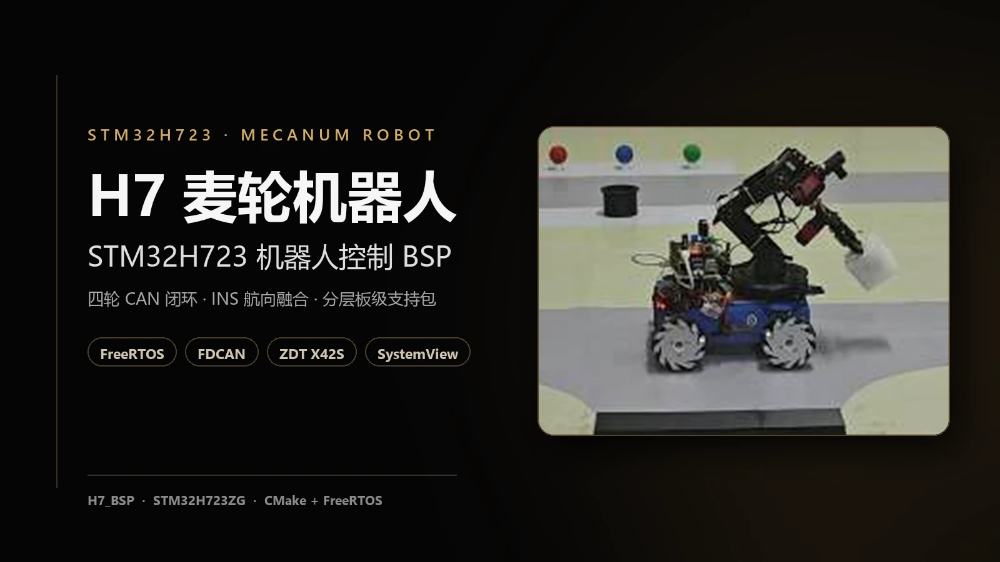
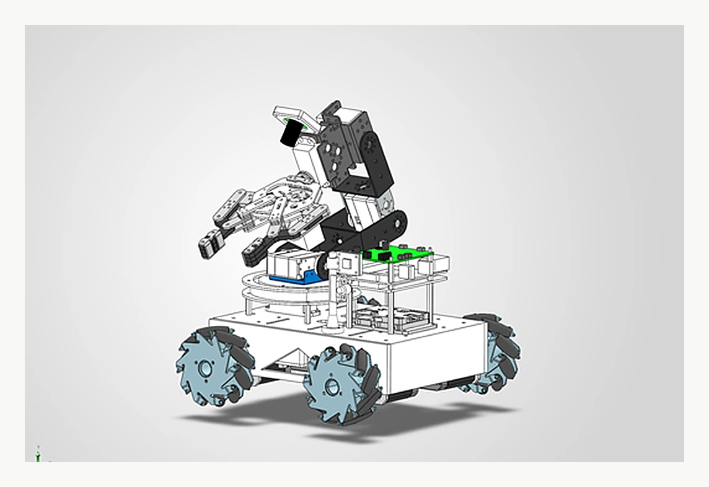

<div align="center">

# H7_BSP · STM32H723 机器人控制平台

**为麦轮机器人打造的分层 BSP：从 DMA 内存布局到四轮 CAN 闭环**



</div>

---

## 这是什么

`H7_BSP` 是面向 STM32H723ZG 机器人控制场景的板级支持包。CubeMX 负责 HAL 外设初始化，`User_File/` 在此基础上维护 C++ BSP、设备驱动、算法组件与 FreeRTOS 任务，并用这层 BSP 搭建了一台四轮麦轮机器人的底盘控制链路。

四台 ZDT X42S 闭环步进电机通过 FDCAN2 接入，底盘层完成麦轮运动学解算、轮式里程计与三轴 PD 位置闭环；BMI088 提供角速度，和四轮反馈融合出 `x / y / yaw`；UART7 与 USB 保留调试遥测接口，SystemView 与 DAPLink 覆盖运行期观测。

## 为什么需要它

STM32H7 的 D-Cache、DMA 与多路外设很容易在真实工程里互相踩坑：DMA 缓冲区放错段会读到缓存里的旧数据，FDCAN 的 Message RAM 配置不当会让多路总线互相覆盖，CAN 命令逐台下发会引入时序差；而只看串口文本，很难同时判断电机掉线、总线错误与位姿漂移。

这个工程把这些基础能力收进一套稳定的分层结构：内存布局、回调分发、CAN/UART/SPI/ADC 封装、设备驱动和任务框架各自归位，上层应用只关心控制逻辑。

## 你会得到什么



- **分层结构**：CubeMX 生成层、硬件 BSP 层、设备驱动层、算法组件层、应用与任务层边界清晰
- **DMA 安全内存**：`.dma_buffer` 统一进入 DMA 可访问 RAM，MPU 配置为 non-cacheable；`heap_5` 按 DTCMRAM/RAM_D1 分区
- **CAN 双通道架构**：周期发送通道 + 异步队列通道，`CanTxTask` 1 ms 调度；四轮速度用一条 `0xAA` 多电机命令同时下发
- **麦轮底盘与 INS**：麦轮正/逆运动学、轮式里程计、陀螺互补滤波、世界系原点校准
- **位置闭环**：三轴 PD（微分先行、输出限幅、航向解缠），支持绝对航点与相对航点
- **可观测调试**：SystemView RTT、UART7 justfloat 遥测、DAPLink 烧录与调试任务

## 演示与 3D 模型

- **演示视频**：[场地实跑（YouTube）](https://youtu.be/SikXQFD-G4A)
- **3D 模型**：[SW Engineering Competition Car（Gitee 开源）](https://gitee.com/aguozimu/sw-engineering-competition-car.git)

## 工作方式

```text
上电
 └─ MPU 配置（RAM_D1 non-cacheable）
    └─ HAL / 时钟 / FDCAN / SPI / UART / ADC 初始化
       └─ System_Init（BSP 绑定、BMI088、时间戳）
          └─ FreeRTOS 启动
             ├─ TIM1msTask   1 / 10 / 50 / 128 ms 回调分发
             ├─ Control_Task 底盘控制与位置闭环
             ├─ InsTask      INS 位姿更新
             ├─ TransportTask 遥测与调试输出
             └─ CanTxTask    周期 CAN 发送
```

## 硬件

| 部件 | 说明 |
| --- | --- |
| 主控 | STM32H723ZG / 达妙 DM-MC-Board02 |
| 底盘 | 四轮麦克纳姆轮，轮半径 0.0375 m，直驱 1:1 |
| 电机 | 4 × ZDT X42S 闭环步进，FDCAN2 扩展帧，500 kbps |
| 姿态 | BMI088（SPI2），Z 轴角速度参与航向融合 |
| 调试 | DAPLink + OpenOCD，SystemView RTT |

## 快速开始

```powershell
# 让 CMake 找到 Arm GNU 工具链；也可以把对应 bin 目录直接加进 PATH
$env:ARM_TOOLCHAIN_DIR = "E:\CubeCLT\STM32CubeCLT_1.22.0\GNU-tools-for-STM32\bin"

cd H7_BSP-main
cmake --preset Debug
cmake --build build/Debug
```

产物：`H7_BSP-main/build/Debug/H7_BSP.elf`

烧录与调试使用 VS Code 任务 `DAPLink: Flash Debug` / `DAPLink: Reset Target`，OpenOCD 配置见 `H7_BSP-main/User_Config/daplink.cfg`。

> 工具链优先使用 `-DARM_TOOLCHAIN_DIR=<path>`，其次读环境变量 `ARM_TOOLCHAIN_DIR`，最后从 `PATH` 查找，不写死某台机器的绝对路径。

## 工程结构

```text
H7_BSP-main/
├─ Core/                  CubeMX 生成的 HAL 初始化
├─ Drivers/               STM32 HAL / CMSIS
├─ Middlewares/           FreeRTOS、USB Device 等
├─ User_File/
│  ├─ Application/        Chassis / INS / Gimbal / Communication
│  ├─ Device/             Onboard 与 Peripheral 驱动（ZDT、BMI088…）
│  ├─ Middleware/         BSP（CAN / UART / SPI / ADC / OSPI）与算法
│  ├─ System/             初始化、回调、时间戳、调试
│  └─ Task/               FreeRTOS 任务入口
├─ User_Config/           DAPLink、链接脚本与 FreeRTOS 补丁
├─ cmake/                 工具链与 CubeMX 集成
└─ CMakePresets.json      构建预设
```

## BSP 能力

| 模块 | 覆盖内容 |
| --- | --- |
| FDCAN | 三路 FDCAN，Message RAM 分区、扩展帧过滤、周期发送与异步队列 |
| UART | 双缓冲 DMA 接收 + IDLE 中断，回调注册模型与阻塞回退 |
| SPI | DMA 收发与设备回调绑定，供 IMU、Flash 等外设使用 |
| ADC | DMA 连续采样，管理对象位于 DMA 可访问段 |
| OSPI | 外部 Flash 访问与自动轮询超时保护 |
| USB | Device CDC 调试通道 |
| 算法 | PID、矩阵、滤波、四元数、EKF 等组件 |

## 机器人应用示例

底盘层把四轮麦轮速度解算、电机收发与位置闭环封装在一起：

- `SetVelocity(x, y, omega)` 计算四轮 RPM，用一条 `0xAA` 多电机命令同时下发
- `RunToPosition(x, y, tolerance, yaw, yaw_tolerance)` 执行绝对航点闭环
- `RunToRelativePosition(dx, dy, …)` 按函数进入时的位姿解释相对位移
- INS 以 10 ms 周期融合四轮里程计与 BMI088 角速度，提供三组世界系位姿和原点校准接口

> 位置环参数、轮径、轴距与 CAN 时序均为当前调试值，换车、换轮或换负载后需要重新标定。

## 调试与观测

- **SystemView**：FreeRTOS 任务切换、运行时间与系统事件
- **UART7 justfloat**：按需注册遥测通道，查看控制量与诊断量
- **DAPLink**：`User_Config/daplink.cfg` 提供 OpenOCD 配置，VS Code 任务可直接烧录与复位

## 关键参数

| 参数 | 当前值 |
| --- | --- |
| MCU | STM32H723ZG，1 MB Flash |
| FDCAN2 | 500 kbps，扩展帧，四轮 ZDT X42S |
| 底盘几何 | 半轴距 0.075 m、半轮距 0.205 m、轮半径 0.0375 m |
| 位置环 | Kp 1.5、Kp_yaw 1.5、Kd 0.25；平移限幅 0.75 m/s |
| INS | 10 ms 更新，航向互补滤波 |

## 进一步阅读

- [工程总览与 BSP 说明](H7_BSP-main/README.md)
- [更新日志](H7_BSP-main/CHANGELOG.md)
- [底盘应用层](H7_BSP-main/User_File/Application/Chassis/Chassis.md)
- [INS 融合与校准](H7_BSP-main/User_File/Application/INS/INS.md)
- [ZDT X42S 协议驱动](H7_BSP-main/User_File/Device/Peripheral/Motor/ZDTmotor/zdtmotor.md)

## 验证状态

当前版本已通过 `cmake --build build/Debug` 构建与链接：FLASH 128,628 B（12.27%）、DTCMRAM 80.67%、RAM_DMA 31.59%。驱动与算法以台架参数为主，实车方向、轮径与闭环增益需按车辆标定后验证。

---

<div align="center">

**H7_BSP · STM32H723ZG · FreeRTOS · FDCAN · INS**

</div>